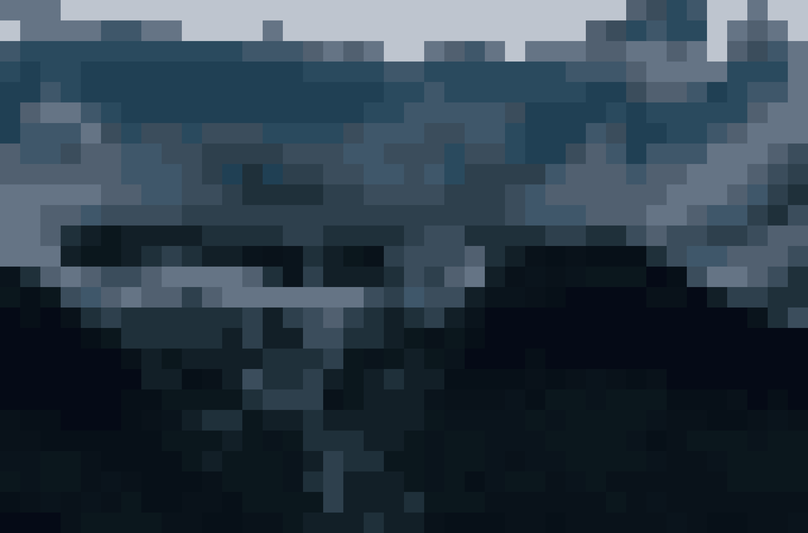

# Pixel Mosaic

A small Python script that turns a photo into a pixel mosaic: big square
blocks and a limited number of colours.

## How it works

1. The photo is shrunk to a tiny image (one pixel per block), each pixel
   being the average colour of its block. The number of blocks is adjustable.
2. The number of colours is reduced to the most representative ones and can be modified.
3. The tiny image is enlarged back to the original size without smoothing,
   so each pixel becomes a sharp square.

## Usage

    pip install -r requirements.txt
    python mosaique.py

Settings are at the top of `mosaique.py`:

- `blocs`: number of blocks across the width (1 to the image width)
- `couleurs`: number of colours (2 to 256)

### Effect of the settings

The fewer `blocs`, the bigger the squares and the harder it is to recognise
the original photo. More blocks give a more precise result.
The same goes for `couleurs`: the lower it is, the smaller the colour palette.

To use your own picture, replace `photo.jpg`.

## Credits

Example photo by eberhard grossgasteiger on Pexels:
https://www.pexels.com/photo/452674/

## About

This project is quite simple and was made for fun and python practice.

Alaa